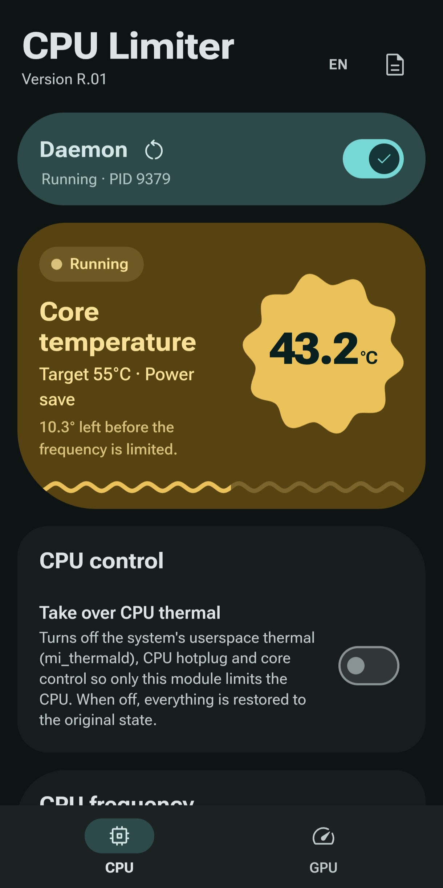
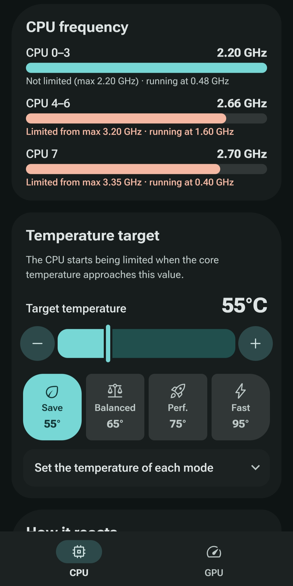
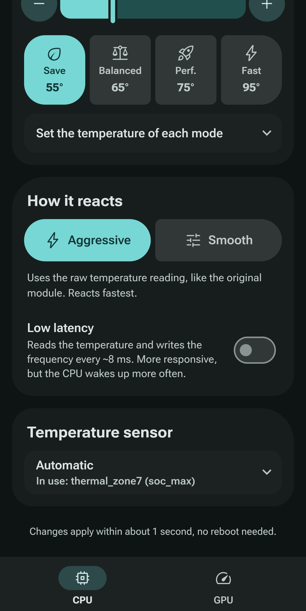
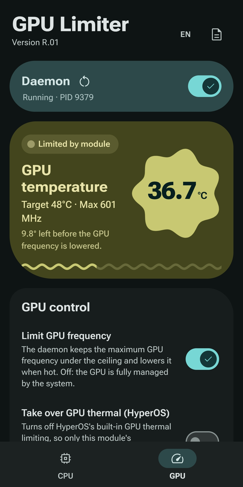
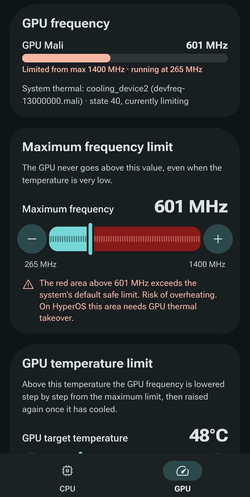
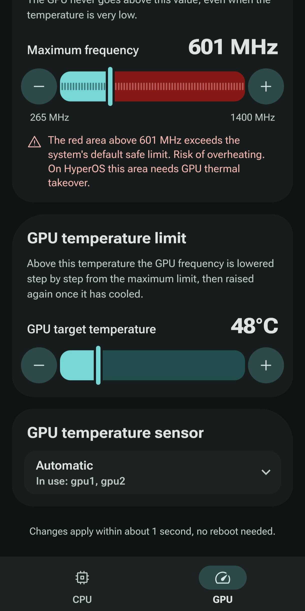

# 🌡️ CPU & GPU Temperature Limiter

**Jaga ponsel tetap adem tanpa menebak-nebak.** Tentukan suhu target, dan modul ini diam-diam mengatur kecepatan CPU dan GPU agar tetap di bawahnya, semuanya lewat WebUI yang bersih dan modern.

[🇬🇧 Read in English](README.md)

<!--
  Jika repositori sudah ada, badge langsung bisa ditambahkan di sini, misalnya:
  
  
-->

## 📸 Tangkapan layar

<table>
<tr><td align="center" width="33%"> CPU · suhu langsung</td><td align="center" width="33%"> CPU · frekuensi dan mode</td><td align="center" width="33%"> CPU · penyetelan dan sensor</td></tr>
<tr><td align="center" width="33%"> GPU · suhu langsung</td><td align="center" width="33%"> GPU · batas frekuensi</td><td align="center" width="33%"> GPU · batas dan sensor</td></tr>
</table>

## 👋 Ini apa?

Ponsel menurunkan kecepatannya sendiri saat panas, tetapi sering terlambat dan turunnya mendadak. Modul ini memantau suhu **berkali-kali tiap detik** dan menurunkan (atau menaikkan) kecepatan maksimum CPU dan GPU **selangkah demi selangkah**, sehingga ponsel tetap lancar dan tetap adem.

Anda yang menentukan batas suhu yang nyaman. Sisanya diurus modul.

## ✨ Fitur utama

| | |
|---|---|
| 🎛️ **Empat mode siap pakai** | Hemat daya, Seimbang, Performa, dan Cepat, masing-masing dengan suhu target sendiri. Atau atur sendiri. |
| 🔗 **Integrasi Scene** | Berjalan bersama aplikasi **Scene**: Scene bisa berganti antara empat mode (hemat daya, seimbang, performa, cepat) dan mengatur preset untuk tiap aplikasi, sehingga setiap aplikasi otomatis punya suhu target sendiri. |
| ⚡ **Dua gaya penyetelan** | **Aggressive** bereaksi seketika. **Smooth** menghindari lonjakan kecepatan mendadak, dengan pengaturan yang bisa diubah. |
| 🕹️ **Opsi latensi rendah** | Cek suhu tiap ~8 ms untuk reaksi tercepat. |
| 🎮 **Limiter GPU** | Batasi kecepatan tertinggi GPU dan atur suhu targetnya. Mendukung **Mali** dan (eksperimental) **Adreno**. |
| 🛡️ **Takeover thermal** | Opsional: matikan pembatasan bawaan sistem agar hanya batas dari Anda yang berlaku. Bisa dikembalikan sepenuhnya. |
| 🌐 **WebUI modern** | Desain Material 3 Expressive, suhu langsung, penampil log, tema terang dan gelap, **bahasa Inggris dan Indonesia**. |
| 🔄 **Tanpa reboot** | Perubahan berlaku dalam sekitar satu detik. |
| 🪶 **Kecil dan ringan** | Satu program Rust kecil, satu thread, hampir tidak memakai CPU. |
| 🔎 **Cek perangkat saat instal** | Langsung memberi tahu apa yang didukung di ponsel Anda dan apa yang tidak. |
| 🧰 **Laporan bug mudah** | Satu ketukan menyimpan laporan perangkat yang bisa dilampirkan ke issue (lihat [Melaporkan masalah](#-melaporkan-masalah)). |

## 🧠 Cara kerja

Bayangkan kecepatan CPU sebagai **tangga**, dengan kecepatan tertinggi di paling atas.

1. Modul membaca suhu dengan sangat sering.
2. Kalau suhu **lebih panas dari target**, ia turun **satu anak tangga** (kecepatan maksimum lebih rendah).
3. Kalau suhu **lebih dingin**, ia naik **satu anak tangga** (lebih leluasa untuk ngebut).
4. Jarak penyangga 1,5 °C mencegahnya naik-turun terus di sekitar target.

GPU memakai ide sederhana yang sama. Karena setiap gerakan hanya satu langkah, hasilnya mudah ditebak dan mudah dipahami.

## 🚀 Instalasi

1. Pasang **KernelSU Next** (atau root manager lain yang mendukung WebUI).
2. Unduh `.zip` terbaru dari halaman [Releases](../../releases).
3. Buka root manager → **Modul** → **Pasang dari penyimpanan** → pilih zip-nya.
4. Baca ringkasan perangkat yang ditampilkan di akhir instalasi.
5. **Reboot**, lalu buka **WebUI** modul dari daftar Modul.

> Kalau modul *CPU Limiter* yang asli masih terpasang, nonaktifkan atau hapus dulu (lalu reboot). Installer akan memberi tahu jika menemukannya.

## 🎛️ Memakai WebUI

- **Kartu Daemon (paling atas):** nyalakan atau matikan limiter, atau restart. Saat mati, pengaturan di bawahnya diabu-abukan dan sistem mengatur panas sendiri.
- **Halaman CPU:** pilih mode, ubah suhu target tiap mode, pilih penyetelan Aggressive atau Smooth, nyalakan Latensi rendah, pilih sensor suhu, dan (di ponsel yang didukung) ambil alih thermal CPU.
- **Halaman GPU:** nyalakan limiter GPU, atur kecepatan GPU tertinggi yang diizinkan, atur suhu target, dan pilih sensor GPU.
- **Tombol Log:** lihat apa yang dikerjakan modul. **Tombol EN/ID:** ganti bahasa.

Pengaturan Anda tersimpan di `/sdcard/Android/naki/clmt/clmt.conf` dan dijelaskan lengkap di dalam file itu.

## 📱 Kompatibilitas

| | Status |
|---|---|
| **Poco X6 Pro** (Dimensity 8300, HyperOS) | ✅ Sudah diuji |
| Ponsel lain dengan GPU **Mali** | 🟡 Seharusnya bisa, belum diuji |
| Ponsel dengan GPU **Adreno** (Snapdragon) | 🧪 Eksperimental, belum diuji di perangkat nyata |
| Takeover thermal CPU | Hanya di ponsel **Xiaomi / Redmi / POCO** |
| Takeover thermal GPU | Hanya untuk GPU **Mali** yang berjalan di **HyperOS** |
| Arsitektur CPU | Hanya arm64 |

Kalau GPU Anda tidak dikenali, halaman GPU akan menyebutkannya dan menyediakan tombol untuk menyimpan laporan, agar dukungannya bisa ditambahkan nanti.

## ⚠️ Perlu diketahui

- Ini **rilis pertama**, dan baru diuji di **satu perangkat**.
- **Limiter GPU**, **takeover thermal**, dan **dukungan Adreno** bersifat eksperimental. Coba dengan hati-hati dan ceritakan hasilnya.
- Menurunkan kecepatan maksimum berarti performa berkurang saat ponsel panas. Itulah tujuannya, jadi pilih target yang nyaman buat Anda.

## 🧯 Aman dan bisa dikembalikan

- Menghentikan daemon dari WebUI mengembalikan semuanya seperti semula.
- Mencopot modul membersihkan sisa-sisanya.
- Tidak ada data yang dikirim ke mana pun. Modul bekerja sepenuhnya offline.

## 🐞 Melaporkan masalah

Silakan buka issue dan lampirkan file **`/sdcard/Android/naki/clmt/gpu-dump.txt`**. Isinya hanya informasi teknis GPU dan thermal (tanpa nomor seri, akun, atau data jaringan). Buka dulu untuk memeriksa isinya. Ada dua cara membuatnya:

- Pada GPU yang tidak didukung, tekan **Simpan data perangkat** di halaman GPU.
- Di ponsel mana pun, buka halaman GPU lalu **ketuk suhu GPU 7 kali dengan cepat**. Sebuah pesan menunjukkan lokasi file tersimpan. Ini juga membantu saat GPU terdeteksi tetapi ada yang tidak berjalan semestinya.

## 🙏 Kredit

- **[nakixii](https://github.com/nakixii/Magisk_CPULimiter)** untuk *Magisk_CPULimiter* yang asli, dasar ide pembatasan CPU modul ini.
- **[ahmed-alnassif](https://github.com/ahmed-alnassif/GPU-Unlocker)** untuk *GPU-Unlocker*, inspirasi sisi GPU.
- Font **Roboto Flex** dari Google, dipakai di bawah SIL Open Font License (lihat `module/webroot/fonts/`).

Semuanya ditulis dari nol dalam Rust, dengan mempelajari cara kerja aslinya, bukan menyalinnya.

## 📜 Lisensi

Dirilis di bawah **GNU General Public License v3.0 atau yang lebih baru**. Lihat [LICENSE](LICENSE).
Hak cipta © 2026 Clourynth.
